<a href="https://fateme-aghababaei.ir"><picture><source media="(prefers-color-scheme: dark)" srcset="./assets/header-dark.svg"></picture></a>

<picture><source media="(prefers-color-scheme: dark)" srcset="./assets/intro-dark.svg"></picture>

<picture><source media="(prefers-color-scheme: dark)" srcset="./assets/label-work-dark.svg"></picture>

<a href="https://memento-words.ir"><picture><source media="(prefers-color-scheme: dark)" srcset="./assets/card-memento-dark.svg"></picture></a>
<a href="https://github.com/Fateme-Aghababaei/konj-newtab-extension"><picture><source media="(prefers-color-scheme: dark)" srcset="./assets/card-konj-dark.svg"></picture></a>
<a href="https://adaksafarasia.ir/"><picture><source media="(prefers-color-scheme: dark)" srcset="./assets/card-adak-dark.svg"></picture></a>
<a href="https://fateme-aghababaei.ir"><picture><source media="(prefers-color-scheme: dark)" srcset="./assets/card-portfolio-dark.svg"></picture></a>

<a href="https://ieeexplore.ieee.org/document/11297643"><picture><source media="(prefers-color-scheme: dark)" srcset="./assets/link-paper-dark.svg"></picture></a>

<picture><source media="(prefers-color-scheme: dark)" srcset="./assets/label-stack-dark.svg"></picture>

<picture><source media="(prefers-color-scheme: dark)" srcset="./assets/stack-dark.svg"></picture>

<picture><source media="(prefers-color-scheme: dark)" srcset="./assets/label-hi-dark.svg"></picture>

<a href="https://fateme-aghababaei.ir"><picture><source media="(prefers-color-scheme: dark)" srcset="./assets/link-portfolio-dark.svg"></picture></a>
<a href="https://www.linkedin.com/in/fateme-aghababaei2002/"><picture><source media="(prefers-color-scheme: dark)" srcset="./assets/link-linkedin-dark.svg"></picture></a>
<a href="https://t.me/ftm_a_q"><picture><source media="(prefers-color-scheme: dark)" srcset="./assets/link-telegram-dark.svg"></picture></a>
<a href="mailto:faghababaei81@gmail.com"><picture><source media="(prefers-color-scheme: dark)" srcset="./assets/link-email-dark.svg"></picture></a>
