<a href="https://fateme-aghababaei.ir"></a>

<a href="https://fateme-aghababaei.ir/">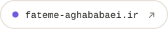</a>
<a href="mailto:faghababaei81@gmail.com">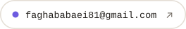</a>
<a href="https://www.linkedin.com/in/fateme-aghababaei2002/"></a>
<a href="https://t.me/ftm_a_q">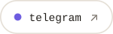</a>


<a href="https://memento-words.ir"></a>

<a href="https://github.com/Fateme-Aghababaei/konj-newtab-extension">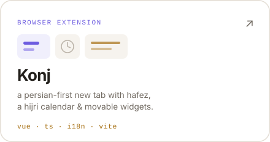</a>
<a href="https://adaksafarasia.ir/">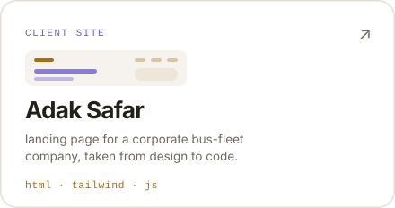</a>
<a href="https://fateme-aghababaei.ir/">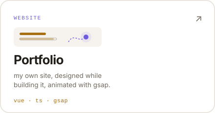</a>
<a href="https://github.com/Fateme-Aghababaei/OrderMe">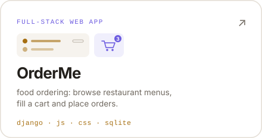</a>

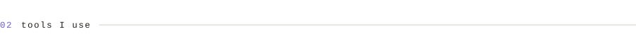

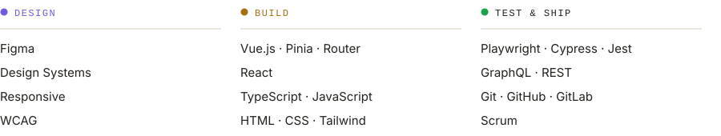
