<a href="https://fateme-aghababaei.ir">
  <picture>
    <source media="(prefers-color-scheme: dark)" srcset="./assets/header-dark.svg">
    
  </picture>
</a>

hey, i'm fateme 👋 i draw interfaces in figma, then build them in vue + typescript. 
by day: dashboards and a design system for a zero trust platform at [payampardaz](https://payampardaz.com).

 

THINGS I'VE MADE

<a href="https://memento-words.ir"><picture><source media="(prefers-color-scheme: dark)" srcset="./assets/card-memento-dark.svg"></picture></a>
<a href="https://github.com/Fateme-Aghababaei/konj-newtab-extension"><picture><source media="(prefers-color-scheme: dark)" srcset="./assets/card-konj-dark.svg"></picture></a>
<a href="https://adaksafarasia.ir/"><picture><source media="(prefers-color-scheme: dark)" srcset="./assets/card-adak-dark.svg"></picture></a>
<a href="https://fateme-aghababaei.ir"><picture><source media="(prefers-color-scheme: dark)" srcset="./assets/card-portfolio-dark.svg"></picture></a>

also wrote [a paper on mutation testing with gpt-4](https://ieeexplore.ieee.org/document/11297643) ↗

 

SAY HI → [portfolio](https://fateme-aghababaei.ir) · [linkedin](https://www.linkedin.com/in/fateme-aghababaei2002/) · [telegram](https://t.me/ftm_a_q) · [email](mailto:faghababaei81@gmail.com)
